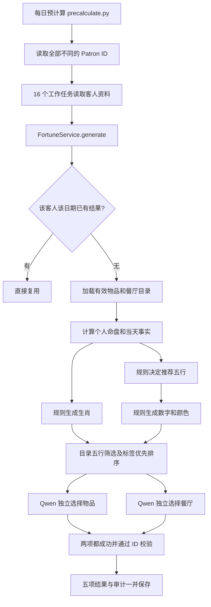

# My Fortune：目录结构、算法与开发说明

本文面向接手 My Fortune 后端的开发者，按当前可执行代码介绍模块职责、输入输出、推荐算法、批量预计算和持久化流程。

数据库和 Qwen/vLLM 的实际连接由项目维护者自行完成及替换。本文保留接入文件位置与调用契约，不展开地址、凭据、驱动安装或部署教程。

## 阅读目录

1. [项目目标与版本](#1-项目目标与版本)
2. [目录结构与文件职责](#2-目录结构与文件职责)
3. [整体调用链](#3-整体调用链)
4. [输入数据与数据模型](#4-输入数据与数据模型)
5. [命盘与日历计算](#5-命盘与日历计算)
6. [推荐五行的生扶策略](#6-推荐五行的生扶策略)
7. [Lucky Zodiac 生肖算法](#7-lucky-zodiac-生肖算法)
8. [Lucky Number 数字算法](#8-lucky-number-数字算法)
9. [Lucky Color 颜色算法](#9-lucky-color-颜色算法)
10. [Lucky Item 与 Lucky Dining](#10-lucky-item-与-lucky-dining)
11. [完整示例](#11-完整示例)
12. [持久化与幂等](#12-持久化与幂等)
13. [批处理与并发](#13-批处理与并发)
14. [REST API](#14-rest-api)
15. [连接替换的接口约定](#15-连接替换的接口约定)
16. [测试、阅读顺序与分工](#16-测试阅读顺序与分工)
17. [当前边界与后续工作](#17-当前边界与后续工作)

## 1. 项目目标与版本

系统每天为 `fortune_patron_source` 中的客人预计算五项推荐，并保存到 `my_fortunes`。前端通过 REST API 查询已经保存的结果。

| 展示内容 | 返回字段 | 当前生成方式 |
| --- | --- | --- |
| Today's Lucky Zodiac | `lucky_zodiac` | 个人四支与当天地支的关系规则 |
| Today's Lucky Number | `lucky_number` | 推荐五行对应的数字组，按日期轮换 |
| Today's Lucky Color | `lucky_color` | 推荐五行对应的颜色组，按日期轮换 |
| Today's Lucky Item | `lucky_item` | 目录规则筛选后，由 Qwen 选择真实条目 |
| Today's Lucky Dining | `lucky_dining` | 目录规则筛选后，由 Qwen 选择真实条目 |

当前运行口径：

| 项目 | 当前值或位置 |
| --- | --- |
| 后端框架 | Python + FastAPI |
| 环境与依赖管理 | uv；默认 Python 3.12，代码要求 Python 3.11+ |
| 规则版本 | `daily-theme-v8`，定义于 `app/rules.py` |
| 默认提示词版本 | `fortune-v6`，定义于 `app/config.py` |
| 业务日期时区 | `Asia/Macau` |
| 历法依赖 | `lunar-python==1.4.9` |
| 天文计算依赖 | `astronomy-engine==2.1.19` |
| 计算引擎标识 | `my-fortune-python / 1.0.0` |
| 批处理工作任务数 | 16 |
| 单个共享 QwenClient 的在途请求上限 | 16 |

这里有三个职责层次：

1. **计算层**：根据出生资料和目标日期，产生四柱、黄历、岁运及干支关系等事实。
2. **规则层**：决定推荐五行、生肖、数字、颜色，以及哪些目录条目可以交给模型。
3. **模型选择层**：Qwen 从真实的物品或餐厅候选中选择一个 ID，返回选择理由。

目前的生扶表、生肖优先顺序和目录标签都是明确约定的产品规则。系统没有完成旺衰、格局、调候、喜用神的完整判断；不能把“已经排出八字”等同于“已经判断出此人命理上最有利的五行”。

## 2. 目录结构与文件职责

### 2.1 项目目录

```text
my-fortune/
├── app/
│   ├── main.py                    # REST 查询入口与接口鉴权
│   ├── precalculate.py            # 每日全表预计算入口
│   ├── service.py                 # 单个客人的完整生成流程
│   ├── rules.py                   # 五行决策、干支常量、目录筛选与排序
│   ├── models.py                  # Patron、Fortune、CatalogEntry 等数据模型
│   ├── config.py                  # 配置对象、版本与并发上限
│   ├── repository.py              # 业务数据读写方法
│   ├── database.py                # 数据库连接与事务上下文
│   ├── llm.py                     # Qwen/vLLM 调用适配
│   ├── taibu.py                   # 保留旧名称的原生 Python 计算入口
│   ├── seed.py                    # 虚构测试数据导入入口
│   ├── calculations/
│   │   ├── engine.py              # 合并个人命盘、黄历、岁运和规则坐标
│   │   ├── calendar.py            # 时区、历法对象、真太阳时
│   │   ├── bazi.py                # 四柱、十神、藏干、十二长生、纳音、运程
│   │   ├── almanac.py             # 目标日期的黄历与日干支
│   │   └── relations.py           # 天干地支的合、冲、刑、害、破等关系
│   └── recommendations/
│       ├── lucky_zodiac.py        # 生肖规则
│       ├── lucky_number.py        # 数字规则
│       ├── lucky_color.py         # 颜色规则
│       ├── lucky_item.py          # 物品候选与模型选择
│       └── lucky_dining.py        # 餐厅候选与模型选择
├── sql/
│   ├── 001_schema.sql             # 初始表结构
│   ├── 002_birth_coordinates.sql  # 旧表补出生坐标字段
│   └── 003_test_data.sql          # 虚构客人、目录和历史预存结果
├── tests/
│   ├── fixtures/taibu_reference.json
│   ├── test_python_calculations.py
│   ├── test_taibu.py
│   ├── test_rules.py
│   ├── test_zodiac.py
│   ├── test_catalog_llm.py
│   ├── test_flow.py
│   ├── test_precalculate.py
│   ├── test_llm_concurrency.py
│   └── test_seed_data.py
├── docs/
│   ├── PROJECT_STRUCTURE_AND_ALGORITHMS.md
│   ├── RULES.md                   # 当前推荐规则的集中说明
│   ├── HANDOFF.md                 # 团队接手与后续工作
│   ├── PYTHON_MIGRATION.md        # 太卜算法迁移范围及验证
│   └── presentations/             # 已制作的演示文稿
├── vendor/
│   ├── UPSTREAM.md               # 算法来源与依赖版本
│   ├── taibu-core/                # 保留的算法说明与许可
│   ├── LUNAR_PYTHON_LICENSE
│   └── ASTRONOMY_ENGINE_LICENSE
├── .env.example
├── .python-version
├── pyproject.toml
├── uv.lock
└── README.md
```

各目录中的 `__init__.py` 是 Python 包标记，目录树中省略。

### 2.2 应该在哪个文件改什么

| 想调整的内容 | 主要文件 | 影响范围 |
| --- | --- | --- |
| 单个客人的计算顺序、调用关系 | `app/service.py` | 整条推荐流水线 |
| 日主和当天五行如何得到推荐五行 | `app/rules.py` | 数字、颜色、物品和餐厅 |
| 生肖候选、避冲、轮换 | `app/recommendations/lucky_zodiac.py` | 幸运生肖及后续目录生肖匹配 |
| 数字映射 | `app/recommendations/lucky_number.py` | 幸运数字 |
| 十种颜色的分组及色值 | `app/recommendations/lucky_color.py` | 幸运色及目录颜色匹配 |
| 物品选择提示词或校验 | `app/recommendations/lucky_item.py` | Lucky Item |
| 餐厅选择提示词或校验 | `app/recommendations/lucky_dining.py` | Lucky Dining |
| 两类目录共用的标签规则 | `app/rules.py` | Item 与 Dining 同时受影响 |
| 排盘与时间计算 | `app/calculations/` | 命理计算事实 |
| 分页、批处理和失败继续 | `app/precalculate.py` | 每日全表任务 |
| 数据源字段映射及持久化 | `app/repository.py` | 业务数据契约 |
| REST 路由及查询错误码 | `app/main.py` | 前端查询接口 |

五项推荐保持五个文件，便于不同开发者分别维护；共同的五行关系和目录筛选放在 `rules.py`，避免两类目录各写一套相互不一致的规则。

## 3. 整体调用链

### 3.1 预计算路径



### 3.2 前端查询路径

```text
GET /v1/patrons/{patron_id}/fortunes/today
    -> main.py
    -> Repository.get_fortune()
    -> my_fortunes.payload
    -> Fortune JSON
```

查询接口不排盘、不调用 Qwen，也不在缺少记录时同步触发生成。未预计算的数据返回 404。

### 3.3 service.py 的十步流程

| 步骤 | 主要输入 | 执行内容 | 输出或结果 |
| --- | --- | --- | --- |
| 1 | Patron ID、目标日期 | 查询已有结果 | 有记录则直接返回 |
| 2 | `kind=item / dining` | 读取两类有效目录 | `item_catalog`、`dining_catalog` |
| 3 | 出生资料、目标日期 | 调用 Python 命盘与黄历计算 | `facts` |
| 4 | 资料、日期、计算事实 | 组装共享上下文 | `context` |
| 5 | 日主天干、当天日干 | 执行固定生扶规则 | `element_decision` |
| 6 | 上一步决策 | 提取推荐五行 | `daily_reading.element` |
| 7 | 个人四支、当日日支、推荐五行、日期 | 生肖、数字、颜色规则 | 三项结果与 `zodiac_decision` |
| 8 | 上下文、两类目录 | 五行硬筛选、标签排序，独立并发调用 Qwen | 两个完整 `CatalogEntry` 与选择审计 |
| 9 | 五项结果与审计 | 构造 `Fortune` 并事务保存 | `my_fortunes` 新记录 |
| 10 | Patron ID、目标日期 | 重新读取最终保存结果 | 返回数据库中的正式结果 |

步骤 8 的“独立”表示餐厅选择不依赖已经选出的物品，两者都使用前面确定的同一份命盘、推荐五行、生肖和颜色。

## 4. 输入数据与数据模型

### 4.1 客人资料：fortune_patron_source / Patron

| 字段 | Python 类型 | 用途 |
| --- | --- | --- |
| `patron_id` | `str` | 客人关联键与结果查询键 |
| `birth_date` | `date \| None` | 公历出生日期 |
| `birth_hour` | `int \| None`，0–23 | 出生小时；缺失时按未知时辰处理 |
| `birth_minute` | `int \| None`，0–59 | 已知小时时，缺失分钟按 0 处理 |
| `gender` | `male / female / None` | 当前排盘入口条件及大运计算输入 |
| `birth_timezone` | `str \| None` | 实际出生地时区，例如 `Asia/Shanghai` |
| `longitude` | `float \| None`，-180–180 | 已知小时且有经度时用于真太阳时修正 |

当前实现只有在 `birth_date`、`gender`、`birth_timezone` 都存在时才构建个人命盘。`personalization` 的取值为：

| 资料情况 | 标记 | 行为 |
| --- | --- | --- |
| 必需出生资料齐全，小时已知 | `four_pillars` | 计算四柱 |
| 必需出生资料齐全，小时未知 | `three_pillars` | 计算年、月、日三柱，不补造时柱 |
| 上述必需资料不齐 | `general` | 使用一般黄历事实，没有个人日主或个人四支 |

`patron_id` 不作为个性化随机种子，也不发送给模型。模型用的 `profile` 只包含出生资料。当前没有 preferences、喜欢的颜色、饮食偏好等客人字段。

### 4.2 目录：fortune_catalog / CatalogEntry

| 数据库字段 | 程序字段或作用 |
| --- | --- |
| `kind` | `item` 或 `dining`，查询时区分两类目录 |
| `entry_id` | 映射为 `CatalogEntry.id` |
| `name` | 映射为 `CatalogEntry.name` |
| `metadata_json` | JSON 字符串，解析后映射为 `CatalogEntry.metadata` 字典 |
| `active` | 只有 `true` 的条目参与生成 |

条目示例：

```json
{
  "id": "ITEM-001",
  "name": "Gold Earrings",
  "metadata": {
    "elements": ["metal"],
    "zodiacs": ["Tiger", "Horse"],
    "colors": ["gold"],
    "category": "jewelry",
    "materials": ["gold"]
  }
}
```

一个商品或餐厅可以有多个五行标签。`category`、`materials`、`cuisine` 描述内容，当前不负责自动推断五行；运营需要明确填写 `elements`。

### 4.3 输出：Fortune

| 字段 | 说明 |
| --- | --- |
| `patron_id`、`fortune_date` | 客人和所属业务日期 |
| `lucky_zodiac` | 英文生肖枚举，如 `Tiger` |
| `lucky_number` | 0–9 的整数 |
| `lucky_color` | `name` 和 `hex` |
| `lucky_item` | 完整 `CatalogEntry`，来自物品目录 |
| `lucky_dining` | 完整 `CatalogEntry`，来自餐厅目录 |
| `generated_at` | 实际生成时间，使用 UTC |
| `model` | 使用的模型名称 |
| `prompt_version` | 提示词版本 |
| `rules_version` | 推荐规则版本 |
| `personalization` | `general / three_pillars / four_pillars` |

### 4.4 共享 context

`context` 是服务内部字典，不是前端响应模型。主要字段如下：

| 字段 | 来源 | 使用方 |
| --- | --- | --- |
| `date` | 目标日期的 ISO 字符串 | 日期轮换、模型 |
| `profile` | 去掉 ID 的 Patron 出生资料 | 模型 |
| `facts` | 原生计算引擎 | 规则、模型、审计 |
| `element_decision` | 生扶规则 | 模型、审计 |
| `daily_reading` | 推荐五行 | 数字、颜色、目录筛选、模型 |
| `zodiac_decision` | 生肖规则 | 模型、审计 |
| `lucky_zodiac` | 已选出的幸运生肖 | 目录生肖匹配、模型 |
| `lucky_color` | 已选出的幸运色 | 目录颜色匹配、模型 |
| `catalog_decisions` | 物品、餐厅模块 | 最终审计 |

`daily_reading` 当前只有 `element`，不再有早期讨论中的 `theme`、`basis`。旧的 `theme_candidates` 加分列表也不再参与当前流程。

## 5. 命盘与日历计算

### 5.1 入口与算法来源

调用链为：

```text
FortuneService.generate()
    -> TaibuClient.context(patron, target_date)
    -> asyncio.to_thread(calculate_context, patron, target_date)
    -> app/calculations/engine.py
```

`TaibuClient` 保留的是历史接口名称。当前在进程内运行原生 Python，没有 Node 适配器或外部太卜桥接服务。

迁移参考太卜核心 `taibu-core 4.1.0 / 4b2a51a` 的部分算法口径，历法与天文计算调用锁定版本的 Python 库。来源及许可见 [vendor/UPSTREAM.md](../vendor/UPSTREAM.md)，详细迁移范围见 [PYTHON_MIGRATION.md](PYTHON_MIGRATION.md)。

### 5.2 五个计算文件

| 文件 | 主要输入 | 主要计算 | 输出 |
| --- | --- | --- | --- |
| `calendar.py` | 出生时区、本地时间、可选经度 | 时区解析、夏令时边界检查、历法对象、真太阳时 | UTC 瞬间、修正后的本地时间及修正依据 |
| `bazi.py` | 出生资料及历法对象 | 四柱、十神、藏干、十二长生、纳音、起运和大运、小运 | 个人命盘、运程参与柱及周期信息 |
| `almanac.py` | 目标日期、可选日主 | 当日日干支、农历、宜忌、冲煞、神煞、日九星等 | 黄历字典及历法对象 |
| `relations.py` | 原局与岁运干支 | 五合、六合、三合、半合、三会、冲刑害破、太岁关系 | 可追溯的干支关系事实 |
| `engine.py` | Patron、目标日期 | 调用以上模块并合并 | 统一 `facts` 字典 |

### 5.3 时间处理口径

1. 出生日期按公历输入，使用实际出生时区，不统一强设为澳门。
2. 年柱、月柱采用出生瞬间换算到固定 UTC+8 后的节气历法口径。
3. 日柱、时柱采用本地时间；有经度且小时已知时，使用真太阳时修正后的时间。
4. 日柱使用午夜换日口径，代码中为 `setSect(2)`。
5. 已知出生小时遇到夏令时重复或不存在时刻，会失败并要求修正输入。
6. 未知时辰会检查当天两端的年/月柱是否变化；跨节气边界而无法确定时会失败。
7. 目标 Fortune 日期使用澳门业务日期。岁运叠加中的流年、流月以该日期澳门中午解析。
8. 目标日期早于出生日期会失败。

真太阳时的修正量由经度、出生时区 UTC 偏移和太阳均时差组成；代码中的分钟关系为：

```text
correction_minutes = longitude × 4 - utc_offset_minutes + equation_of_time
```

计算结果同时保存修正前后时间、经度、偏移量和日期变化信息，便于审计。

### 5.4 facts 的输出与实际用途

| facts 字段 | 内容 | 当前如何使用 |
| --- | --- | --- |
| `engine` | 引擎、上游和依赖版本 | 来源追溯 |
| `personalization` | 个性化完整度 | 保存到 Fortune |
| `bazi` | 个人命盘完整事实 | 模型参考与审计 |
| `almanac` | 当天黄历完整事实 | 模型参考与审计 |
| `relations` | 原局、岁运及太岁关系 | 模型参考与审计 |
| `coordinates.day_master` | 个人日柱天干 | 推荐五行规则 |
| `coordinates.day_stem` | 当天日干 | 推荐五行规则 |
| `coordinates.day_branch` | 当天日支 | 生肖规则 |
| `coordinates.natal` | 已知个人柱的标签、天干、地支 | 生肖规则读取四支 |

因此，排盘会产生很多输出，但当前确定性推荐并没有逐项消费所有输出。十神、藏干、大运、流月等事实可以提供给 Qwen参考，不参与当前生扶表和生肖表的硬判断。

## 6. 推荐五行的生扶策略

### 6.1 输入、输出与调用者

| 项目 | 内容 |
| --- | --- |
| 实现 | `app/rules.py::daily_element_decision(facts)` |
| 调用者 | `FortuneService.generate()` 第 5 步 |
| 输入 | `coordinates.day_master`、`coordinates.day_stem` |
| 输出 | 推荐五行、关系代码、选择策略、中文理由 |

“日主”是个人日柱的天干。例如日柱为丙子，日主就是丙，五行属火；日柱为庚辰，日主是庚，五行属金。

天干五行映射：

| 天干 | 五行代码 | 中文 |
| --- | --- | --- |
| 甲、乙 | `wood` | 木 |
| 丙、丁 | `fire` | 火 |
| 戊、己 | `earth` | 土 |
| 庚、辛 | `metal` | 金 |
| 壬、癸 | `water` | 水 |

相生链为木 → 火 → 土 → 金 → 水 → 木；相克链为木 → 土 → 水 → 火 → 金 → 木。

### 6.2 条件选择表

表中的“我”指个人日主五行，“生我五行”指能够生成个人日主的五行。

| 当天与个人的关系 | 代码 | 推荐方向 | 丙火日主的例子 |
| --- | --- | --- | --- |
| 当天生我 | `generates_master` | 生我五行 | 当天木 → 推荐木 |
| 当天同我 | `same` | 日主五行 | 当天火 → 推荐火 |
| 我生当天 | `generated_by_master` | 生我五行 | 当天土 → 推荐木 |
| 我克当天 | `controlled_by_master` | 日主五行 | 当天金 → 推荐火 |
| 当天克我 | `controls_master` | 生我五行 | 当天水 → 推荐木 |

解释方向分别为延续生助、同类帮助、补充被泄出的支持、帮助承担消耗、借相生链缓和克制。它们是本项目固定的生扶策略，不先判断这个人究竟身强还是身弱。

### 6.3 五种日主的完整映射

列是**当日日干五行**，单元格是**最终推荐五行**。

| 个人日主五行 | 当天木 | 当天火 | 当天土 | 当天金 | 当天水 |
| --- | --- | --- | --- | --- | --- |
| 木 | 木 | 水 | 木 | 水 | 水 |
| 火 | 木 | 火 | 木 | 火 | 木 |
| 土 | 火 | 火 | 土 | 火 | 土 |
| 金 | 金 | 土 | 土 | 金 | 土 |
| 水 | 金 | 水 | 金 | 金 | 水 |

在有个人日主的生扶模式中，一个人输出范围通常只有“自身五行”和“生自身的五行”两种。这是当前规则的结果，不保证个人五行分布均匀，也没有随机切换到“泄耗制约”模式。

### 6.4 输出示例与一般模式

个人日主庚金、当天日干戊土时，土生金，输出为：

```json
{
  "strategy": "support",
  "day_master_element": "metal",
  "day_element": "earth",
  "relationship": "generates_master",
  "element": "earth",
  "reason": "当天五行生助日主，采用生我五行延续生助方向。"
}
```

随后 `service.py` 提取：

```json
{"element": "earth"}
```

并将其保存为 `context.daily_reading`。后续数字、颜色和目录筛选全部使用这个**推荐五行**，不直接拿“当天五行”替代。

如果没有个人日主，返回 `strategy=general`，`day_master_element` 和 `relationship` 为 `null`，直接使用当天日干五行作为一般主题。

## 7. Lucky Zodiac 生肖算法

### 7.1 核心原则

实现位于 `app/recommendations/lucky_zodiac.py::generate(context)`。

**个人四支的六合伙伴决定候选范围，当天日支决定避冲和优先关系。** 不使用推荐五行，也不对各柱加权评分。

这里的个人四支为年、月、日、时柱的地支；未知时辰只读取实际已有的三支。

### 7.2 基础关系表

| 地支 | 生肖 | 六合伙伴 | 六冲对象 | 所属三合组 |
| --- | --- | --- | --- | --- |
| 子 | Rat 鼠 | 丑 | 午 | 申子辰 |
| 丑 | Ox 牛 | 子 | 未 | 巳酉丑 |
| 寅 | Tiger 虎 | 亥 | 申 | 寅午戌 |
| 卯 | Rabbit 兔 | 戌 | 酉 | 亥卯未 |
| 辰 | Dragon 龙 | 酉 | 戌 | 申子辰 |
| 巳 | Snake 蛇 | 申 | 亥 | 巳酉丑 |
| 午 | Horse 马 | 未 | 子 | 寅午戌 |
| 未 | Goat 羊 | 午 | 丑 | 亥卯未 |
| 申 | Monkey 猴 | 巳 | 寅 | 申子辰 |
| 酉 | Rooster 鸡 | 辰 | 卯 | 巳酉丑 |
| 戌 | Dog 狗 | 卯 | 辰 | 寅午戌 |
| 亥 | Pig 猪 | 寅 | 巳 | 亥卯未 |

“同属三合组”只表示候选与当天在同一组且不是同一个地支，不表示两个字已经构成完整三合化局。

### 7.3 六步选择过程

1. **构建个人候选**：分别取已知四支的六合伙伴，合并去重；重复地支不增加权重。
2. **排除当天六冲**：候选与当日日支六冲时移除。当前不把“与个人其他某柱相冲”设成额外否决条件。
3. **必要时扩展**：若个人六合候选全部被排除，取个人各支同属三合组的另外两支，去重后再次排除当天六冲。
4. **选出当天优先池**：候选中与当天六合、或同属三合组的条目同等优先。两种关系没有高低之分。
5. **按日期选择**：有优先池就从中选；没有则从剩余全部候选选。先按固定地支顺序排列，再取 `date.toordinal() % 候选数`。
6. **一般模式**：没有个人地支时，直接返回当天的六合生肖。

固定排序为：

```text
子、丑、寅、卯、辰、巳、午、未、申、酉、戌、亥
```

日期序数取自 Python `date.toordinal()`，不是简单使用“几号”。同样的目标日期、个人计算坐标和规则版本会得到相同的确定性生肖。

### 7.4 输出与审计

函数直接返回 `Zodiac` 枚举，同时向 `context.zodiac_decision` 写入过程数据。

| 审计字段 | 说明 |
| --- | --- |
| `candidate_source` | `personal_combines`、`personal_trines` 或 `daily_combine` |
| `personal_branches` | 实际参与的个人柱及地支 |
| `candidate_origins` | 每一柱对应的初始六合候选 |
| `base_candidates`、`base_excluded` | 初始候选及被当天六冲排除的候选 |
| `fallback_candidates`、`fallback_excluded` | 扩展候选及其排除结果 |
| `eligible_candidates` | 避冲后仍可选的候选 |
| `preferred_candidates` | 当天相合优先池 |
| `selection_pool`、`rotation_index` | 实际选择池与日期索引 |
| `daily_relationship` | `combine / trine_group / neutral` |
| `selected_branch`、`zodiac`、`reason` | 最终地支、生肖及解释 |

当前算法允许候选与当天没有特别相合关系，只要不冲且来自个人候选；此时 `daily_relationship=neutral`。它也不保证十二生肖均匀出现或每位客人结果唯一。

## 8. Lucky Number 数字算法

实现位于 `app/recommendations/lucky_number.py::generate(context)`。

| 推荐五行 | 固定数字组 |
| --- | --- |
| 水 `water` | `[1, 6]` |
| 火 `fire` | `[2, 7]` |
| 木 `wood` | `[3, 8]` |
| 金 `metal` | `[4, 9]` |
| 土 `earth` | `[5, 0]` |

选择公式：

```text
pair = NUMBERS[daily_reading.element]
number = pair[target_date.toordinal() % 2]
```

土使用 0 是本产品把数字 10 表达为单个数字的约定。该模块不调用 Qwen，也不直接读取出生资料；个人化来自上游已经确定的推荐五行。

## 9. Lucky Color 颜色算法

实现位于 `app/recommendations/lucky_color.py::generate(context)`。

| 推荐五行 | 颜色及色值，顺序即轮换顺序 |
| --- | --- |
| 木 | Green `#228B22` |
| 火 | Red `#C62828`、Purple `#7B1FA2`、Orange `#FF9800`、Pink `#E91E63` |
| 土 | Yellow `#FBC02D`、Brown `#795548` |
| 金 | Gold `#D4AF37`、Silver `#C0C0C0` |
| 水 | Blue `#1565C0` |

选择公式：

```text
palette = PALETTES[daily_reading.element]
color = palette[target_date.toordinal() % len(palette)]
```

共十种颜色。木、水各只有一种颜色，因此即使每天执行，推荐五行相同也可能连续返回同一种颜色。火、土、金按各自组内数量轮换；索引取决于目标日期，不是为每个客人保存一个递增计数器。

颜色分组与色值是产品配置。当前不读取客人喜欢的颜色，也不使用模型生成颜色。

## 10. Lucky Item 与 Lucky Dining

### 10.1 两个独立入口

| 项目 | Lucky Item | Lucky Dining |
| --- | --- | --- |
| 文件 | `app/recommendations/lucky_item.py` | `app/recommendations/lucky_dining.py` |
| 函数 | `generate(llm, context, catalog)` | `generate(llm, context, catalog)` |
| 输入目录 | `kind=item` 的有效条目 | `kind=dining` 的有效条目 |
| 共用规则 | `rank_catalog()`、`catalog_matches()` | 同左 |
| 模型输出模型 | 本文件中的 `Selection` | 本文件中的 `Selection` |
| 函数最终输出 | 完整物品 `CatalogEntry` | 完整餐厅 `CatalogEntry` |
| 审计写入位置 | `context.catalog_decisions.item` | `context.catalog_decisions.dining` |

两类模块都先执行规则筛选，再调用 Qwen。餐厅不接收“已经选出的物品”作为前提。

### 10.2 目录标签契约

标签放在现有 `fortune_catalog.metadata_json` 内，不新增数据库列。

| 标签 | 是否必需 | 精确规则 |
| --- | --- | --- |
| `elements` | 要参与当前推荐就必须有匹配值 | 字符串数组；允许 `wood/fire/earth/metal/water`；大小写严格匹配 |
| `zodiacs` | 可选 | 字符串数组；使用 `Zodiac` 英文枚举，如 `Tiger`、`Rooster`；大小写严格匹配 |
| `colors` | 可选 | 字符串数组；与幸运色名称比较时忽略大小写 |
| `category` | 可选描述 | 商品品类，供模型参考 |
| `materials` | 可选描述 | 商品材质，供模型参考 |
| `cuisine` | 可选描述 | 餐厅菜系，供模型参考 |

`elements` 缺失或空数组的条目不会入选。`zodiacs`、`colors` 缺失按空数组处理。

如填写了上述三个数组标签，但其格式不是数组、内容不是字符串，或五行/生肖出现未知值，当前生成会报错，并标明条目 ID 与标签名。例如 `"elements": "metal"` 不合法，必须写成 `"elements": ["metal"]`。

`zodiacs` 匹配的是**已经算出的幸运生肖**，不是直接匹配客人出生年的生肖。例：客人本人属鼠，但当天幸运生肖是虎，目录优先匹配 `Tiger`。

这些标签代表本产品对商品、餐厅主题的配置。例如为一个金属饰品标记 `metal`，或为一个餐厅标记金色主题。程序不自动推导“所有珠宝都属金”“所有粤菜都属金”，也不要求标签有唯一传统命理解释。

### 10.3 硬筛选与优先排序

`Repository.catalog()` 的 SQL 只按 `kind` 和 `active=true` 取数；五行及标签判断在 Python 中完成，不依赖数据库 JSON 函数。

`rank_catalog(context, catalog, kind)` 按下面顺序执行：

1. 对目录标签做格式与取值校验。
2. **硬筛选五行**：`daily_reading.element` 必须存在于条目的 `elements` 中。
3. 在合格目录内，生肖匹配者优先。
4. 生肖优先级相同时，颜色匹配者优先。
5. 仍相同时按条目 ID 升序。
6. 各推荐模块取排序后的前 20 个，交给 Qwen。

| 条件 | 对候选的影响 |
| --- | --- |
| 五行不匹配 | 排除，即使生肖和颜色都匹配 |
| 生肖匹配 | 提高排序优先级 |
| 生肖不匹配或未填写 | 保留，只要五行匹配 |
| 颜色匹配 | 在生肖同档内优先 |
| 没有任何五行匹配条目 | 该项生成失败，不跨五行兜底 |

此处没有五行 +5、颜色 +2 等数字打分；使用的是明确的优先级排序。

例如推荐五行 `metal`、幸运生肖 `Tiger`、幸运色 `Gold`：

| 条目 | 标签 | 是否入选与顺序 |
| --- | --- | --- |
| 金耳环 | metal、Tiger、gold | 入选，生肖与颜色都匹配 |
| 金属腕表 | metal、Tiger | 入选，生肖匹配 |
| 金色手链 | metal、gold | 入选，仅颜色匹配 |
| 银手链 | metal | 入选，无额外匹配 |
| 木制虎摆件 | wood、Tiger、gold | 五行不匹配，排除 |

### 10.4 Qwen 的输入

共享上下文加上筛选后的 `candidates`，构成每次模型请求的数据。下例是**精简结构示意**，省略了完整命盘及各项决策字典：

```json
{
  "date": "2026-11-20",
  "profile": {},
  "daily_reading": {"element": "metal"},
  "lucky_zodiac": "Tiger",
  "lucky_color": {"name": "Gold", "hex": "#D4AF37"},
  "candidates": [
    {
      "id": "ITEM-001",
      "name": "Gold Earrings",
      "metadata": {
        "elements": ["metal"],
        "zodiacs": ["Tiger", "Horse"],
        "colors": ["gold"],
        "category": "jewelry"
      },
      "rule_matches": {"element": true, "zodiac": true, "color": true}
    }
  ]
}
```

实际请求还包含出生资料、`facts`、`element_decision`、`zodiac_decision`，以及各模块独立的选择上下文。上例只说明请求结构，完整一致的计算案例见第 11 节。

Qwen 的工作是比较候选的名称、材质、品类、菜系等描述，结合已提供的事实选择条目并解释。它不重新排盘，也不能添加目录里没有的商品或餐厅。

### 10.5 Qwen 的输出与校验

两个模块都要求模型返回且只返回下面两个字段：

```json
{
  "entry_id": "ITEM-001",
  "reason": "The metal and Tiger tags match the supplied daily theme."
}
```

| 校验项 | 当前规则 |
| --- | --- |
| JSON 格式 | 使用 Pydantic `model_validate_json()` 解析 |
| 字段 | `Selection` 只允许 `entry_id`、`reason` |
| 理由长度 | 1–1000 字符 |
| 返回 ID | 必须在本次实际发给模型的最多 20 个候选中 |
| 完整条目 | 根据 ID 从原候选对象取回，不使用模型编造的名称或 metadata |

生肖和颜色是优先信号，模型仍可以选择候选池内较低优先级的条目。当前程序不会因为它没选第一名就拒绝结果，但会保留理由和标签命中情况。

当前连接适配器将 JSON schema 写入提示词，并在返回后做校验；没有在请求中强制设置 vLLM 结构化解码参数。替换模型连接时，可以保留上层 `Selection` 契约。

### 10.6 审计内容

`audit_json.catalog_decisions.item` 和 `.dining` 分别保存：

| 字段 | 内容 |
| --- | --- |
| `entry_id` | 最终目录 ID |
| `reason` | 模型返回的理由 |
| `required_element` | 该次生成要求的推荐五行 |
| `lucky_zodiac` | 该次生成的幸运生肖 |
| `candidate_ids` | 实际提供给模型的候选 ID 列表 |
| `rule_matches` | 选中条目是否命中 element、zodiac、color |
| `matched_tags` | 实际命中的五行、生肖和颜色名称 |

`matched_tags.colors` 使用幸运色的标准名称，例如 `Gold`；目录标签本身可以写成 `gold`。

## 11. 完整示例

本例使用虚构客人 `EXAMPLE-P001`，独立于 SQL 中的 `DEMO-P001`。出生资料、规则结果与候选排序已用当前 Python 代码核算；物品和餐厅的模型返回为示意，不代表真实 Qwen 调用记录。

### 11.1 输入

```json
{
  "patron_id": "EXAMPLE-P001",
  "birth_date": "1990-01-15",
  "birth_hour": 9,
  "birth_minute": 0,
  "birth_timezone": "Asia/Shanghai",
  "gender": "male",
  "longitude": null
}
```

目标业务日期：`2026-11-20`，日期序数为 `739940`。

### 11.2 命盘计算输出

| 项目 | 结果 |
| --- | --- |
| 年柱 | 己巳 |
| 月柱 | 丁丑 |
| 日柱 | 庚辰 |
| 时柱 | 辛巳 |
| 日主 | 庚，属金 |
| 个人四支 | 巳、丑、辰、巳 |
| 当天干支 | 戊戌 |
| 当天日干五行 | 戊，属土 |
| 当天日支 | 戌 |
| 个性化标记 | `four_pillars` |

### 11.3 推荐五行

```text
个人：金
当天：土
关系：土生金，即 generates_master
策略：support
推荐：earth（土）
```

这一步由 `daily_element_decision()` 完成，不调用 Qwen。

### 11.4 幸运生肖

| 个人地支 | 六合候选 |
| --- | --- |
| 巳 | 申，Monkey |
| 丑 | 子，Rat |
| 辰 | 酉，Rooster |
| 巳 | 申，Monkey，与前面的申重复 |

去重并按固定地支顺序排列后：`[子, 申, 酉]`。

- 当天戌的六冲对象为辰，三个候选中没有辰，因此没有排除项。
- 当天六合为卯，同组三合伙伴为寅、午，三个候选均未命中当天优先关系。
- 因此使用全部剩余候选 `[子, 申, 酉]`。
- `739940 % 3 = 2`，选择索引 2 的酉。

结果为 **Rooster（鸡）**，`daily_relationship=neutral`。

### 11.5 幸运数字与颜色

| 推荐项 | 计算 | 结果 |
| --- | --- | --- |
| 数字 | 土对应 `[5, 0]`；`739940 % 2 = 0` | **5** |
| 颜色 | 土对应 `[Yellow, Brown]`；`739940 % 2 = 0` | **Yellow，#FBC02D** |

### 11.6 从测试目录筛选候选

共享条件为：`element=earth`、`lucky_zodiac=Rooster`、`color=Yellow`。

物品候选排序：

| 顺序 | ID | 名称 | 五行匹配 | 生肖匹配 | 颜色匹配 |
| --- | --- | --- | --- | --- | --- |
| 1 | DEMO-I009 | Yellow Ceramic Cup | 是 | 否 | 是 |
| 2 | DEMO-I004 | Brown Ceramic Charm | 是 | 否 | 否 |

餐厅候选排序：

| 顺序 | ID | 名称 | 五行匹配 | 生肖匹配 | 颜色匹配 |
| --- | --- | --- | --- | --- | --- |
| 1 | DEMO-D003 | Golden Cantonese Kitchen (Demo) | 是 | 是 | 是 |
| 2 | DEMO-D005 | Earth Table (Demo) | 是 | 否 | 否 |

其他五行的目录条目不会进入本例的模型候选。D003 同时有 `metal`、`earth` 标签，因此在土主题下可以入选。

### 11.7 两次独立模型选择

物品模型返回示意：

```json
{
  "entry_id": "DEMO-I009",
  "reason": "The ceramic cup matches the Earth theme and the Yellow lucky color."
}
```

餐厅模型返回示意：

```json
{
  "entry_id": "DEMO-D003",
  "reason": "The restaurant matches the Earth, Rooster, and Yellow tags."
}
```

程序分别校验 ID，然后从原候选中取得完整条目。

### 11.8 最终五项与持久化

| 字段 | 本例结果 |
| --- | --- |
| `lucky_zodiac` | Rooster |
| `lucky_number` | 5 |
| `lucky_color` | Yellow，#FBC02D |
| `lucky_item` | DEMO-I009，Yellow Ceramic Cup |
| `lucky_dining` | DEMO-D003，Golden Cantonese Kitchen (Demo) |

连同 `rules_version=daily-theme-v8`、实际使用的模型名称和提示词版本，组装成完整 `Fortune`。同一次保存还包含原始 `facts`、生扶依据、生肖候选过程和两次模型选择理由。

## 12. 持久化与幂等

### 12.1 三张表的职责

| 表 | 方向 | 内容 |
| --- | --- | --- |
| `fortune_patron_source` | 输入 | 客人出生资料 |
| `fortune_catalog` | 输入 | 可推荐的真实物品、餐厅及标签 |
| `my_fortunes` | 输出 | 每个客人每天的完整推荐与审计 |

`my_fortunes` 当前保存 `patron_id`、`fortune_date`、`generated_at`、`payload`、`audit_json`。后两者为序列化 JSON 字符串，参考表结构使用 `VARCHAR(64000)`。

`payload` 是可供前端读取的 `Fortune`；`audit_json` 包括：

```text
facts                  原始命盘、黄历和岁运事实
reading.element        最终推荐五行
rules_version          推荐规则版本
element_decision       生扶选择的输入、关系及理由
zodiac_decision        生肖候选、排除、轮换与结果
catalog_decisions
  item                 物品候选、命中标签、模型理由
  dining               餐厅候选、命中标签、模型理由
```

### 12.2 同一客人同一天如何复用

1. `service.py` 开始时查询该客人和该日期；已有结果就直接返回，后续排盘和模型调用都跳过。
2. 保存时再次检查同样的键，避免两个工作任务同时生成时重复发布。
3. 当前 Repository 通过短事务、表锁、存在性检查和插入来发布完整结果。
4. 保存后再次读取数据库，确保返回正式记录；如果另一个任务先发布，以已保存的那份为准。

业务幂等键是 `(patron_id, fortune_date)`。参考 DDL 没有用唯一约束替代上述锁协议，接手者替换保存实现时仍需保证该语义。

### 12.3 “每日全量更新”的实际含义

每天遍历全体客人，为**新的业务日期**生成结果。已有日期的成功记录不自动覆盖。

因此：

- 规则从 v7 升级为 v8，不会自动重算已经保存的同日结果。
- 更新出生资料或目录标签，也不会自动修改历史成功记录。
- 重跑失败批次时，成功记录复用，缺失记录重新生成。
- 如果未来需要强制重算或按规则版本重新发布，需要单独设计任务和历史策略；目前没有 `--force` 参数。

### 12.4 个人命盘是否保存

完整命盘事实会随每日日志保存在 `audit_json.facts` 中，但当前没有独立的“个人命盘缓存表”。

每个尚无结果的客人/日期组合仍会重新执行排盘；命中已有 Fortune 时则整体跳过。这与“把命盘独立计算一次后长期复用”是两种不同实现，目前按现有方式运行。

## 13. 批处理与并发

### 13.1 全表任务

入口为 `app/precalculate.py`：

```bash
uv run --locked python -m app.precalculate --date 2026-11-20
```

不传日期时使用澳门当天日期。任务不要求外部逐个传 Patron ID：

```text
iter_patron_ids(batch_size)
    -> 读取全部不同的 ID
    -> 队列
    -> 工作任务 get_patron(id)
    -> FortuneService.generate(patron, target_date)
```

当前分页是 ID 分页，之后仍逐个读取出生资料；没有批量读取完整 Patron 行或批量写入全部结果。数据源应为一个 Patron ID 提供一致的资料，`DISTINCT` 只消除重复 ID，不负责合并互相冲突的出生资料。

### 13.2 三个不同的数量

| 参数或限制 | 当前值 | 控制什么 |
| --- | --- | --- |
| `--batch-size` | 默认 500 | 每页从数据库取多少个不同 ID |
| 工作任务数 | 16 | 同时处理多少位客人的流水线 |
| 等待队列上限 | 32 | 已读取但尚未开始处理的 ID 数量 |
| Qwen 请求上限 | 16 | 共享客户端同时有多少个 HTTP 请求在途 |

例：16 位客人可以各自产生物品和餐厅两个模型任务，但共享信号量只允许其中最多 16 个请求同时发出。

这里使用普通并发请求，由 vLLM 服务处理；没有调用离线 Batch API，也没有把多位客人拼成一个大提示词。每位新生成且成功的客人有两次逻辑模型选择，临时网络失败可能产生额外重试请求。

这些限制按单个批处理进程及其共享 QwenClient 生效，不是跨进程全局限流。若多个进程同时运行，总请求数需要由部署或上层调度协调。

### 13.3 失败与退出行为

| 失败位置 | 当前行为 |
| --- | --- |
| 某位客人的资料、计算或模型选择失败 | 记录错误、计入失败数，继续处理其他客人 |
| 物品或餐厅任一子任务失败 | TaskGroup 取消另一项尚未完成的任务，本客人不发布部分结果 |
| 数据源分页失败或批任务被取消 | TaskGroup 结束该批任务 |
| Qwen HTTP 429、502、503、504 或传输异常 | 最多 3 次尝试，重试等待时释放并发名额 |
| Qwen JSON/schema 或候选 ID 不合法 | 不自动放宽条件，当前客人生成失败 |
| 批次存在客人失败 | CLI 非零退出，供调度器识别 |

`run()` 返回失败客人数。日志中的成功数量包括已经存在并复用的结果，不全部代表本轮新调用模型生成的数量。

## 14. REST API

入口为 `app/main.py`，只查询已经发布的数据。

| 方法与路径 | 用途 |
| --- | --- |
| `GET /health/live` | 进程存活检查 |
| `GET /v1/patrons/{patron_id}/fortunes/today` | 按澳门当天日期查询 |
| `GET /v1/patrons/{patron_id}/fortunes/{fortune_date}` | 查询指定日期，格式 YYYY-MM-DD |
| `GET /docs` | FastAPI 交互文档 |
| `GET /openapi.json` | OpenAPI 规范 |

业务查询接口使用内部 `X-API-Key`。当前鉴权没有根据用户登录身份限制其只能访问自己的 Patron ID，客户身份范围应由现有网关或后续鉴权逻辑承担。

| 状态码 | 含义 |
| --- | --- |
| 200 | 返回完整 Fortune |
| 401 | API key 不合法 |
| 404 | 该客人该日期没有已保存结果 |
| 422 | 日期等路径参数不合法 |
| 503 | 结果存储查询发生异常 |

目前没有用于生成任务的 POST 路由；生成入口为 CLI 和外部调度器。

## 15. 连接替换的接口约定

实际连接由项目维护者自行修改。只要保留以下契约，推荐算法不需要理解连接细节。

### 15.1 数据库一侧

| 方法 | 输入 | 输出或保证 |
| --- | --- | --- |
| `get_patron(patron_id)` | 客人 ID | `Patron` 或 `None` |
| `iter_patron_ids(batch_size)` | 分页大小 | 逐个产生全部不同的 ID |
| `get_fortune(patron_id, target_date)` | 客人和日期 | `Fortune` 或 `None` |
| `catalog(kind)` | item 或 dining | 该类型有效条目的 `list[CatalogEntry]` |
| `save(fortune, audit)` | 完整结果和审计 | 原子保存，不覆盖相同客人/日期的成功结果 |

数据库连接上下文位于 `database.py`，业务 SQL 和字段映射位于 `repository.py`。当前接口是同步方法，服务使用 `asyncio.to_thread()` 调用；如果维护者改成异步驱动，需要同步调整调用方，避免把 coroutine 当作结果。

`metadata_json` 在 Repository 中解析为 Python 字典。应保持真实 ID、`active` 过滤、两类目录隔离，以及结果与审计同事务保存等业务语义。

### 15.2 大模型一侧

上层依赖的接口为：

```python
async def generate(task: str, context: dict, schema: type[T]) -> T:
    ...
```

| 输入或输出 | 约定 |
| --- | --- |
| `task` | 当前模块的选择指令 |
| `context` | 出生资料、计算事实、推荐结果、候选 |
| `schema` | 物品或餐厅模块定义的 `Selection` Pydantic 类型 |
| 返回值 | 已校验的 `Selection` 实例，上层访问 `.entry_id` 和 `.reason` |

若实际客户端返回原始文本或 HTTP response，需要在适配层解析并校验后再交回上层。当前有限并发、失败传播和两项独立调用的行为应保留。

不论底层连接如何实现，最终目录 ID 是否属于本次 shortlist 的检查仍由 `lucky_item.py`、`lucky_dining.py` 执行。

## 16. 测试、阅读顺序与分工

### 16.1 测试文件与关注点

| 测试文件 | 主要覆盖 |
| --- | --- |
| `test_python_calculations.py` | 与 20 组上游快照对照、时区与计算边界 |
| `test_taibu.py` | 原生计算入口及资料完整度 |
| `test_rules.py` | 五种日主 × 五种当天五行、生扶关系、数字和颜色 |
| `test_zodiac.py` | 四支候选、去重、当天避冲、同等优先、日期轮换、兜底 |
| `test_catalog_llm.py` | 五行硬筛选、生肖/颜色优先、标签格式、20 候选上限、模型 ID 校验 |
| `test_flow.py` | 五项生成、审计保存、幂等、失败不发布、查询链路 |
| `test_precalculate.py` | 全表分页、16 并发、单客人失败继续 |
| `test_llm_concurrency.py` | 共享请求信号量及相关客户端行为 |
| `test_seed_data.py` | SQL 重复导入、历史快照、五行候选覆盖 |

运行现有测试：

```bash
uv run --locked pytest -q
```

当前测试套件为 107 项。真实命盘计算会执行，服务流程中的数据库和模型主要使用替身；本地 SQLite 用于检查 SQL 测试数据，不作为实际 Yellowbrick 连接实现的替代说明。

### 16.2 建议阅读顺序

1. `models.py`：理解客人、目录和最终响应。
2. `service.py`：理解十步流程与共享上下文。
3. `rules.py`：理解推荐五行和目录规则。
4. `recommendations/`：分别阅读五项推荐。
5. `calculations/engine.py`：理解排盘输入及统一输出，再按需要进入各计算文件。
6. `precalculate.py`：理解全表调度与有限并发。
7. `repository.py`、`llm.py`：对照自己维护的连接实现与接口契约。
8. `main.py`：理解前端如何读取结果。

### 16.3 分工建议

| 工作包 | 主要维护内容 | 与其他模块的约定 |
| --- | --- | --- |
| 计算层 | calendar、bazi、almanac、relations | 保持 `facts.coordinates` 的字段含义稳定 |
| 五行与数字颜色 | `daily_element_decision`、number、color | 修改规则时更新版本与对应样例 |
| 生肖 | zodiac 文件、分支关系表 | 返回枚举并保留可追溯的候选过程 |
| 目录与运营标签 | 商品、餐厅数据及 metadata | 保证元素覆盖、标签格式、有效 ID |
| 物品/餐厅模型选择 | 两个独立推荐文件 | 只能选择 shortlist 内的 ID，保存理由 |
| 服务与批处理 | service、precalculate | 保持全量任务、幂等、并发限制及完整发布 |
| API | main、Fortune 输出契约 | 查询不隐式触发模型生成 |

### 16.4 测试数据与旧文档

`sql/003_test_data.sql` 当前包括 6 位虚构客人、10 件物品、10 家虚构餐厅，其中 1 家餐厅停用；每种五行的有效物品和餐厅各至少两个候选。

脚本还保留 2026-11-19、2026-11-20 两天共 10 份旧版 v5 预存结果，标记 `model=fixture-no-llm`。这些结果用于展示和兼容测试，不是当前 v8 的预期输出，也不是真实模型调用证据。

直接导入测试脚本会替换明确列出的 DEMO 输入和两天的 DEMO 结果。`seed.py --with-llm` 模式保留已发布结果，只重载 DEMO 输入后运行全表生成；其生成范围仍是整个数据源，不仅限于 DEMO 客人。

`docs/presentations/` 中的既有 PPT 包含旧版规则示例。对当前算法应优先阅读本文件、`RULES.md` 与代码，不应直接从旧 PPT 推断当前行为。

## 17. 当前边界与后续工作

以下内容尚未实现，接手时不要当作现有能力：

| 内容 | 当前状态 |
| --- | --- |
| 完整旺衰、格局、调候、喜用神判断 | 未实现；当前是固定生扶方向 |
| 随机生扶/制约或五行均衡配额 | 未实现 |
| 个人命盘独立缓存 | 未实现；命盘随日结果审计保存 |
| 客人 preferences、喜欢的颜色、饮食偏好筛选 | 当前不使用 |
| 商品品类/菜系自动推导五行 | 未实现；依赖明确标签 |
| 生肖到具体赌场玩法的映射 | 未实现 |
| 所有客人推荐绝对唯一、五行或生肖均匀分布 | 不保证 |
| 持久化批任务状态、失败明细表、自动调度 | 当前以 CLI、日志及外部调度为基础 |
| 完整 Patron 批量读取、结果批量写入 | 未实现 |
| 多进程全局 Qwen 限流 | 未实现；当前按共享客户端限制 |
| 强制覆盖已发布结果 | 未提供对应参数或 API |

后续可以按团队实际需要推进：独立缓存稳定命盘、复用批次目录、优化批量读写、记录任务状态、明确版本重算策略，以及基于测试客群检查推荐覆盖和分布。连接实现由维护者继续管理，不需要为修改连接而重写上述推荐规则。
